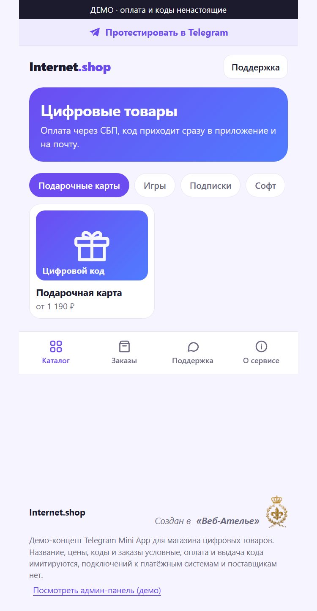
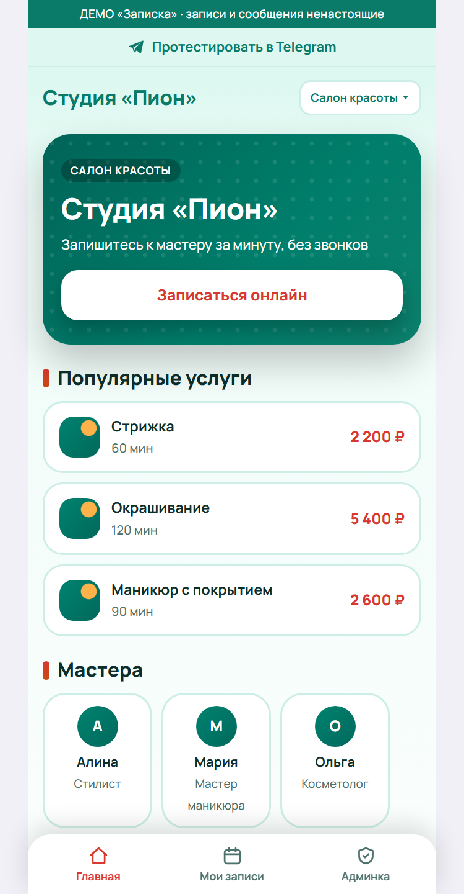
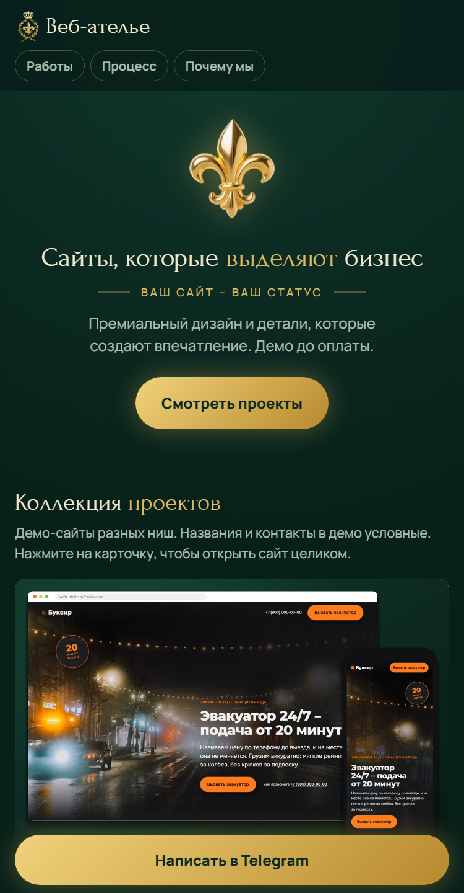

# Mini Apps

## Telegram Mini App для разных задач бизнеса

Мини-приложения открываются прямо в Telegram, без установки. Это демо-версии: названия, цены и данные условные, платёжных систем и мессенджеров к ним не подключено.

---

## Internet.shop – магазин цифровых товаров

Приложение для продажи цифровых товаров: подарочные карты, игры, подписки, софт. Покупатель выбирает товар в каталоге, оформляет заказ, платит через СБП, и код сразу приходит в приложение. В разделе «Заказы» хранится история покупок, есть раздел «Поддержка» и страница «О сервисе». Для владельца есть демо-админ-панель.

Ссылка на проект - [Открыть демо](https://web-atelie.ru/internet-shop/) / бот [@internetshop_demo_bot](https://t.me/internetshop_demo_bot)

---

## Записка – онлайн-запись клиентов

Универсальное приложение для любого бизнеса с записью: салон красоты, барбершоп, автомойка, клиника. Клиент выбирает услугу и мастера, затем удобное время и записывается без звонков. В разделе «Мои записи» он видит свои визиты. В админке владелец смотрит шкалу загрузки, переносит и отменяет записи, меняет тексты сообщений. Под каждую нишу есть свой цвет и набор услуг.

Ссылка на проект - [Открыть демо](https://web-atelie.ru/zapiska/) / бот [@zapiska_demo_bot](https://t.me/zapiska_demo_bot)

---

## Веб-ателье – витрина работ

Приложение-портфолио студии «Веб-ателье»: коллекция демо-сайтов разных ниш, описание того, как проходит работа над сайтом, и преимущества. Клиент листает карточки, открывает любой сайт целиком и пишет в Telegram прямо из приложения. Список работ подтягивается с главной страницы студии и обновляется сам.

Ссылка на проект - [Открыть демо](https://web-atelie.ru/app/) / бот [@web_atelie_bot](https://t.me/web_atelie_bot)

---

Ссылка на сайт студии: [web-atelie.ru](https://web-atelie.ru/) / Ссылка на резюме: [Резюме](https://web-atelie.ru/Resume/)
